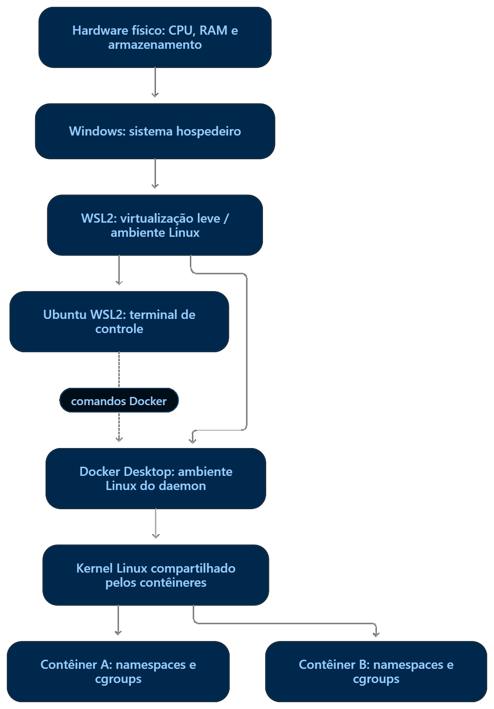
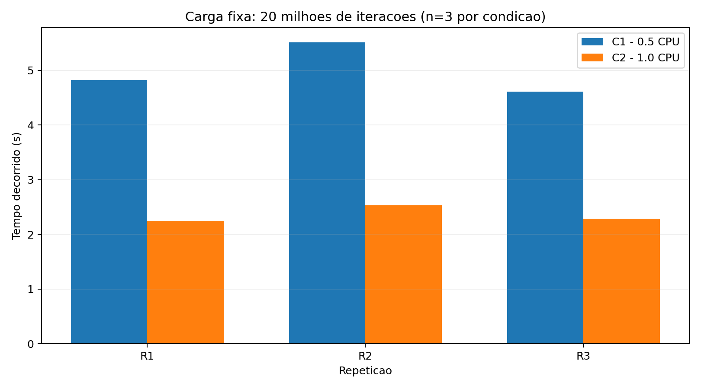

# Sistemas Operacionais — Atividade 3

**Virtualização, contêineres, namespaces e cgroups**

**Discente:** Roberdan Tamyr dos Santos Feitosa Junior  
[**Relatório técnico**](docs/relatorio.pdf)
[**Vídeo de apresentação**](https://google.com)
[**Guaia do vídeo**](docs/VIDEO.md)
[**Declaração de uso de IA**](docs/declaração_de_uso_de_IA.pdf)

## 1. Objetivo

Esta atividade investiga mecanismos de isolamento e controle de recursos em contêineres Linux, com foco em namespaces, cgroups v2 e montagens somente leitura.

O laboratório busca responder à seguinte pergunta:

> Como namespaces alteram a visão de processos, mounts e rede, e como cgroups limitam recursos sem transformar um contêiner em uma máquina virtual independente?

Foram realizados três experimentos:

1. Comparação dos namespaces PID, mount e network de dois contêineres independentes.
2. Comparação de uma carga determinística de CPU sob quotas de 0,5 e 1,0 CPU.
3. Demonstração de leitura permitida e escrita negada em um diretório montado como somente leitura.

O laboratório utiliza Docker e Python, sem necessidade de executar modelos de linguagem.

## 2. Ambiente de execução

| Componente | Configuração |
|---|---|
| Sistema do terminal | Ubuntu 24.04.3 LTS |
| Virtualização | WSL2 |
| Kernel Linux | 6.6.87.2-microsoft-standard-WSL2 |
| Arquitetura | x86_64 |
| CPUs lógicas | 16 |
| RAM disponível ao ambiente | Aproximadamente 15 GiB |
| Swap | 4 GiB |
| Docker Desktop | 4.55.0 |
| Docker Engine | 29.1.3 |
| Docker Compose | v2.40.3 |
| Cgroups | v2 |
| Driver de cgroups | cgroupfs |
| Controladores disponíveis | cpuset, cpu, io, memory, hugetlb, pids, rdma |

O terminal utilizado pertence a uma distribuição Ubuntu executada no WSL2. O daemon Docker pertence ao ambiente Linux gerenciado pelo Docker Desktop.

Os contêineres compartilham o kernel Linux do ambiente do daemon, mas utilizam namespaces para isolamento e cgroups para controle de recursos.

O diretório do projeto estava localizado em `/mnt/c/`, correspondente a um sistema de arquivos do Windows acessado pelo WSL2.

### 2.1 Imagem utilizada

Imagem oficial Python 3.12-slim, fixada por digest:

```text
python@sha256:5e2bdb1b0d542d5039cffb8181c65930093949194a65c365dfb1b0fe13a4fa5b
```

O uso do digest evita que uma atualização posterior da tag altere silenciosamente a imagem utilizada.

### 2.2 Arquitetura

O laboratório utiliza a infraestrutura física do computador, o ambiente de virtualização WSL2/Docker Desktop e o kernel Linux compartilhado pelos contêineres.

Os contêineres não possuem kernels independentes. Os namespaces restringem a visão de determinados recursos, enquanto os cgroups estabelecem limites de consumo.



## 3. Organização do repositório

```text
.
├── data/
│   └── text.txt
├── docs/
├── evidences/
│   ├── environment/
│   │   └── system.txt
│   ├── 20261110T200944Z-2953/
│   └── 20261110T205454Z-4333/
├── results/
│   ├── metrics.csv
│   ├── plots/
│   │   └── cpu_wall_time.png
│   └── raw/
│       └── 20261110T190158Z/
├── scripts/
│   ├── cpu_load.py
│   ├── evidences_ns_mount.sh
│   ├── run_experiments.sh
│   └── summary.py
├── .gitignore
└── README.md
```

Os diretórios `results/raw/` e `evidences/` preservam as evidências das execuções, enquanto `results/metrics.csv` contém os resultados consolidados.

## 4. Preparação e reprodução

### 4.1 Pré-requisitos

- Ambiente Linux com Docker funcional.
- Suporte a cgroups v2 e aos controladores `cpu`, `memory` e `pids`.
- Python 3 para consolidação dos resultados.
- Biblioteca Matplotlib para geração do gráfico.
- Bash e utilitários básicos do Linux.

Os experimentos foram executados com Docker Desktop integrado ao WSL2.

### 4.2 Verificação do ambiente

```bash
uname -a
cat /etc/os-release
nproc
free -h

docker version
docker compose version

docker info --format \
'Cgroup={{.CgroupVersion}} Driver={{.CgroupDriver}}'
```

Verificar também os controladores disponíveis:

```bash
docker run --rm \
  python@sha256:5e2bdb1b0d542d5039cffb8181c65930093949194a65c365dfb1b0fe13a4fa5b \
  cat /sys/fs/cgroup/cgroup.controllers
```

### 4.3 Obtenção da imagem

```bash
docker pull python@sha256:5e2bdb1b0d542d5039cffb8181c65930093949194a65c365dfb1b0fe13a4fa5b
```

### 4.4 Execução dos experimentos de CPU

Na raiz do repositório:

```bash
chmod +x scripts/run_experiments.sh
./scripts/run_experiments.sh
```

O script executa seis testes, alternando as condições C1 e C2, com três repetições por condição.

Cada execução registra os limites efetivos, contadores do cgroup, resultado da carga, status e horários.

Os resultados são preservados em um diretório identificado pelo horário UTC da bateria.

O script utiliza timeout interno de 60 segundos para a carga Python e timeout externo de 90 segundos para o comando Docker. Em caso de encerramento anormal, realiza uma tentativa de limpeza do contêiner correspondente. Os resultados oficiais apresentados foram coletados antes dessa melhoria no script, sem ocorrência de timeout.

### 4.5 Consolidação dos resultados

Criar um ambiente virtual Python:

```bash
python3 -m venv .venv
source .venv/bin/activate
pip install matplotlib
```

Executar:

```bash
python3 scripts/summary.py
```

O script gera:

- `results/metrics.csv`: métricas consolidadas das seis execuções.
- `results/plots/cpu_wall_time.png`: comparação do tempo decorrido.
- Resumo no terminal com medianas, valores mínimos e máximos e contadores de throttling.

### 4.6 Experimento de namespaces e mount

```bash
chmod +x scripts/evidences_ns_mount.sh
./scripts/evidences_ns_mount.sh
```

O script cria dois contêineres temporários, registra seus namespaces e executa o teste de montagem somente leitura.

Ao finalizar, remove os contêineres criados pelo próprio script e preserva as evidências no diretório `evidences/`.

## 5. Experimento 1 — Namespaces

Foram executados dois contêineres independentes da mesma imagem, ambos utilizando o processo `sleep` como PID 1 interno.

Os PIDs observados pelo daemon foram 2867 e 2912.

| Namespace | Contêiner A | Contêiner B |
|---|---|---|
| PID | `pid:[4026532416]` | `pid:[4026532490]` |
| Mount | `mnt:[4026532230]` | `mnt:[4026532487]` |
| Network | `net:[4026532418]` | `net:[4026532492]` |

Os valores correspondem à execução registrada em evidences/20261110T205454Z-4333/. Os identificadores de processos e namespaces são específicos de cada execução e podem mudar quando novos contêineres são criados.

Todos os handles observados foram diferentes entre os dois contêineres.

Isso demonstra que os processos pertencem a instâncias distintas dos namespaces analisados.

Embora ambos possuam um PID 1 em suas respectivas visões, não representam o mesmo processo no host do daemon.

A diferença dos handles não comprova isolamento absoluto de segurança, nem implica existência de kernels independentes.

## 6. Experimento 2 — Cgroups e quotas de CPU

### 6.1 Configurações

Foi utilizada uma carga aritmética determinística implementada em Python.

| Parâmetro | C1 | C2 |
|---|---|---|
| Quota de CPU | 0,5 CPU | 1,0 CPU |
| Memória máxima | 256 MiB | 256 MiB |
| Swap adicional | 0 | 0 |
| Limite de PIDs | 64 | 64 |
| Iterações | 20.000.000 | 20.000.000 |
| Repetições | 3 | 3 |

O número de iterações foi definido após execuções piloto e mantido constante durante a bateria oficial.

O checksum esperado foi `464056848`, confirmado nas seis execuções.

Os valores de `cpu.max` foram:

- C1: `50000 100000`
- C2: `100000 100000`

Esses valores representam quotas de tempo de CPU por período, e não afinidade com um núcleo físico específico.

### 6.2 Resultados individuais

| Execução | Wall time (s) | CPU time (s) | Trabalho/s |
|---|---:|---:|---:|
| C1-R1 | 4,825 | 2,433 | 4.144.942 |
| C1-R2 | 5,509 | 2,764 | 3.630.421 |
| C1-R3 | 4,608 | 2,310 | 4.340.180 |
| C2-R1 | 2,249 | 2,239 | 8.893.019 |
| C2-R2 | 2,534 | 2,528 | 7.893.452 |
| C2-R3 | 2,287 | 2,281 | 8.745.748 |

Todas as execuções foram concluídas com sucesso, sem divergência de checksum.

### 6.3 Resultados consolidados

| Métrica (mediana) | C1 | C2 |
|---|---:|---:|
| Wall time | 4,825 s | 2,287 s |
| CPU time | 2,433 s | 2,281 s |
| Trabalho/s | 4,14 milhões | 8,75 milhões |
| Delta `nr_throttled` | 51 | 4 |
| Delta `throttled_usec` | 2.481.509 µs | 1.175 µs |
| `memory.peak` | 12,25 MiB | 12,25 MiB |

A mediana do tempo decorrido em C1 foi aproximadamente 2,11 vezes a de C2.

A maior quota de CPU permitiu concluir o mesmo trabalho em menor tempo, com menor incidência de throttling.

O contador `nr_throttled` apresentou mediana de 51 em C1 e 4 em C2, fornecendo evidência direta da atuação do mecanismo de controle de CPU.

Os resultados não representam garantia de ganho exato de 2 vezes em outros ambientes ou cargas.

### 6.4 Gráfico



O gráfico apresenta as três repetições por condição, com tempo decorrido em segundos.

### 6.5 Memória e paginação

Foram coletadas métricas distintas de memória:

- **RSS:** memória residente observada para o processo Python.
- **`memory.current`:** consumo de memória contabilizado pelo cgroup no instante da leitura.
- **`memory.peak`:** maior consumo de memória contabilizado pelo cgroup desde sua criação.

As execuções permaneceram abaixo do limite configurado de 256 MiB.

Também foram registradas faltas de página menores e maiores do processo. Esses valores, isoladamente, não permitem concluir que houve pressão intensa de memória ou thrashing.

## 7. Experimento 3 — Montagem somente leitura

Um diretório contendo um documento sintético foi montado no contêiner em `/dados`, utilizando a opção `readonly`.

O contêiner foi executado com:

- Usuário não root (`uid=65534`).
- Todas as capabilities adicionais removidas com `--cap-drop ALL`.
- Restrição `no-new-privileges`.
- Rede desabilitada.

A leitura do arquivo foi concluída:

```text
Documento sintetico para AV3
```

A tentativa de escrita retornou:

```text
Codigo de saida do touch: 1
Mensagem de erro:
touch: cannot touch '/dados/novo.txt': Read-only file system
SUCESSO: escrita negada pelo mount read-only
```

Além de verificar o código de saída e a mensagem de erro, o script confirmou que /dados/novo.txt não foi criado.

O resultado confirma que a montagem permitiu leitura e impediu a criação do arquivo no diretório protegido.

O mecanismo de montagem somente leitura é diferente do isolamento por namespace e das permissões associadas à identidade do processo.

Essas proteções são complementares e não garantem isolamento absoluto do host.

## 8. Relação com aplicações de IA generativa

Os mecanismos observados são relevantes para serviços de inferência compartilhados.

Namespaces permitem separar a visão de processos, pontos de montagem e recursos de rede entre serviços.

Cgroups permitem limitar o consumo de CPU, memória e tarefas, reduzindo o risco de uma carga comprometer recursos compartilhados.

Montagens somente leitura podem proteger datasets, índices, configurações e outros artefatos que não precisam ser modificados durante a inferência.

Entretanto, contêineres compartilham o kernel Linux, e os limites de CPU observados não representam limites genéricos de VRAM ou garantias de desempenho para modelos de linguagem.

## 9. Segurança e limitações

O laboratório adotou carga determinística, limites explícitos de recursos, rede desabilitada e arquivos sintéticos.

Não foram realizados testes deliberados de esgotamento de memória, fork bomb, alteração do escalonador ou acesso a diretórios sensíveis do host.

Entre as limitações estão:

- Ambiente virtualizado e compartilhado com outras cargas.
- Apenas três repetições por condição.
- Carga sequencial e predominantemente limitada por CPU.
- Ausência de inferência real de modelos de linguagem.
- Possível influência de frequência da CPU, escalonamento e ruído do ambiente.
- Ausência de avaliação de isolamento contra ataques adversariais.

Os resultados descrevem o comportamento observado no ambiente experimental e não devem ser generalizados diretamente para infraestruturas distribuídas ou aceleradores de IA.

## 10. Limpeza

Os contêineres temporários do experimento de namespaces são removidos automaticamente ao término do script.

Os contêineres de CPU utilizam `--rm`.

Os arquivos de evidência e resultados são preservados para reprodução e auditoria.

Para verificar possíveis contêineres remanescentes:

```bash
docker ps -a
```

Não é necessário remover imagens ou volumes de outros projetos.

## 11. Artefatos da entrega

| Artefato | Local |
|---|---|
| Código dos experimentos | `scripts/` |
| Resultados brutos | `results/raw/` |
| Métricas consolidadas | `results/metrics.csv` |
| Gráfico | `results/plots/` |
| Evidências de namespaces | `evidences/` |
| Evidência de mount read-only | `evidences/` |
| Relatório técnico | `docs/relatorio.pdf` |
| Apresentação | `docs/apresentacao.pdf` |
| Declaração de IA | `docs/AI_USAGE.md` |
| Registro do vídeo | `docs/VIDEO.md` |

**Vídeo de apresentação:** URL a inserir após publicação.

## 12. Contribuição individual

| Discente | Contribuição |
|---|---|
| Roberdan Tamyr dos Santos Feitosa Junior | Preparação e validação do ambiente; execução dos experimentos; coleta e análise dos resultados; verificação das evidências; organização dos artefatos; documentação e apresentação. |

## 13. Referências

- Linux man-pages. **namespaces(7)**. https://man7.org/linux/man-pages/man7/namespaces.7.html
- Linux Kernel Documentation. **Control Group v2**. https://docs.kernel.org/admin-guide/cgroup-v2.html
- Docker Documentation. **Resource constraints**. https://docs.docker.com/engine/containers/resource_constraints/
- Docker Documentation. **Bind mounts**. https://docs.docker.com/engine/storage/bind-mounts/
