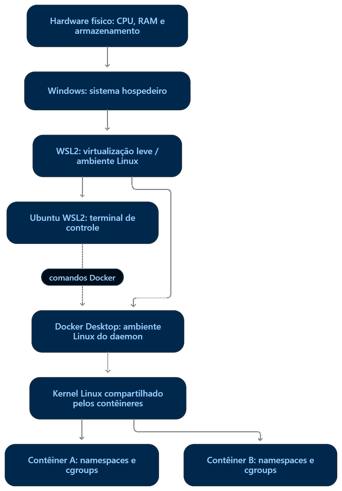
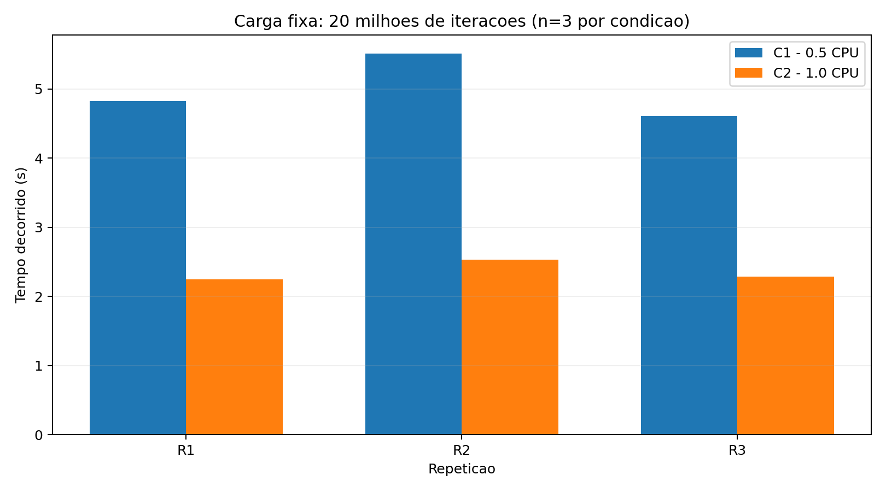

<div align="left" style="padding: 0 40px;">

# Relatório técnico - Isolamento e controle de recursos em contêineres Linux

Discente: Roberdan Tamyr dos Santos Feitosa Junior

Repositório: https://github.com/LeeYooBin/SO_UFS_2026_2_Santos_Roberdan_AV3

Vídeo: 
</div>

<div style="page-break-after: always;"></div>
<div style="padding: 0 40px;">

### Sumário

[Resumo](#resumo)  
[1. Introdução e objetivos](#1-introdução-e-objetivos)  
[2. Ambiente e arquitetura](#2-ambiente-e-arquitetura)  
[3. Experimento I - Comparação de namespaces](#3-experimento-i--comparação-de-namespaces)  
[4. Experimento II - Quotas de CPU com cgroups v2](#4-experimento-ii--quotas-de-cpu-com-cgroups-v2)  
[5. Experimento III - Montagem somente leitura e menor privilégio](#5-experimento-iii--montagem-somente-leitura-e-menor-privilégio)  
[6. Discussão integrada e aplicação à inferência de IA](#6-discussão-integrada-e-aplicação-à-inferência-de-ia)  
[7. Reprodutibilidade, integridade e limitações operacionais](#7-reprodutibilidade-integridade-e-limitações-operacionais)  
[8. Conclusão](#8-conclusão)  
[9. Contribuição individual e artefatos](#9-contribuição-individual-e-artefatos)  
[Referências](#referências)

</div>

<div style="page-break-after: always;"></div>

<div style="text-align: justify; padding: 0 40px;">

## Resumo

Este relatório investiga o isolamento de processos e o controle de recursos em contêineres Linux executados com Docker Desktop e WSL2. O laboratório foi dividido em três experimentos: (i) comparação de namespaces PID, mount e network entre dois contêineres; (ii) execução de carga aritmética determinística sob quotas de 0,5 e 1,0 CPU, com três repetições por condição; e (iii) verificação de leitura permitida e escrita negada em uma montagem somente leitura. Os contêineres apresentaram identificadores distintos para os três namespaces. No experimento de CPU, a mediana do tempo decorrido foi de 4,825 s na condição C1 e 2,287 s na condição C2, acompanhada por redução expressiva dos eventos de throttling em C2. A montagem read-only permitiu ler um documento sintético e rejeitou a criação de um arquivo com a mensagem `Read-only file system`. Os resultados evidenciam mecanismos de isolamento e limitação implementados pelo kernel Linux, sem caracterizar os contêineres como máquinas virtuais independentes.

## 1. Introdução e objetivos

A execução de múltiplos serviços sobre a mesma infraestrutura exige mecanismos capazes de separar a visão de recursos e controlar seu consumo. No Linux, namespaces oferecem diferentes visões de recursos do sistema, enquanto control groups (cgroups) permitem contabilizar e limitar o uso de recursos por conjuntos de processos. Contêineres combinam esses mecanismos com configurações de montagem, identidade e políticas de segurança, mas continuam utilizando o kernel do ambiente em que são executados.

A pergunta norteadora da atividade é: **como namespaces alteram a visão de processos, mounts e rede, e como cgroups limitam recursos sem transformar um contêiner em uma máquina virtual independente?**

O objetivo geral é demonstrar empiricamente esses mecanismos por meio de comandos, registros e medições reproduzíveis. Especificamente, busca-se: identificar a arquitetura de execução; comparar três namespaces entre contêineres; confirmar limites efetivos de CPU, memória e tarefas; analisar uma carga de trabalho fixa sob duas quotas de CPU; e comprovar uma restrição de escrita em montagem read-only. Por fim, discute-se a aplicabilidade desses mecanismos a servidores compartilhados de inferência de IA.

## 2. Ambiente e arquitetura

### 2.1 Caracterização do ambiente

O laboratório foi executado em um terminal Ubuntu integrado ao Windows por WSL2, utilizando o daemon do Docker Desktop. As informações foram coletadas por `uname`, `/etc/os-release`, `nproc`, `free`, `docker version`, `docker compose version`, `docker info` e leitura dos controladores de cgroups disponíveis no contêiner.

| Elemento | Valor observado |
|---|---|
| Distribuição do terminal | Ubuntu 24.04.3 LTS (Noble Numbat) |
| Plataforma de execução | Windows, WSL2 e Docker Desktop |
| Sistema reportado pelo daemon | Docker Desktop 4.55.0 |
| Kernel Linux | `6.6.87.2-microsoft-standard-WSL2` |
| Arquitetura | `x86_64` / `linux/amd64` |
| CPUs lógicas | 16 |
| Memória do ambiente | Aproximadamente 15 GiB (`16402022400` bytes reportados pelo daemon) |
| Swap informado pelo terminal | 4 GiB |
| Docker Engine / CLI | 29.1.3 |
| Docker Compose | v2.40.3-desktop.1 |
| Versão de cgroups | v2 |
| Driver de cgroups | `cgroupfs` |
| Controladores observados | `cpuset cpu io memory hugetlb pids rdma` |

A distribuição Ubuntu é o ambiente do **terminal**. O daemon pertence ao ambiente Linux gerenciado pelo Docker Desktop. Portanto, o PID retornado por `docker inspect` é relativo ao host do **daemon**, não necessariamente ao namespace de processos do terminal Ubuntu. A coincidência da versão do kernel reportada pelos ambientes não implica identidade entre seus namespaces de processos.

O projeto foi executado a partir de um diretório em `/mnt/c/`, isto é, um sistema de arquivos do Windows acessível pelo WSL2. Essa característica é registrada como possível fonte de variação para operações de E/S, embora a carga principal seja predominantemente computacional.

### 2.2 Diagrama de camadas



**Figura 1 —** Esquema conceitual das camadas utilizadas no laboratório. A representação simplifica a integração entre Docker Desktop e WSL2: não afirma que o Ubuntu do terminal e o ambiente do daemon sejam a mesma distribuição ou o mesmo namespace. O ponto central é que os contêineres executados pelo daemon compartilham o kernel Linux de seu ambiente de execução, em vez de inicializarem kernels próprios.

### 2.3 Imagem e reprodutibilidade

Foi utilizada a imagem oficial `python:3.12-slim`, referenciada por digest imutável:

```text
python@sha256:5e2bdb1b0d542d5039cffb8181c65930093949194a65c365dfb1b0fe13a4fa5b
```

O digest foi confirmado com `docker image inspect`. Os scripts executam a imagem diretamente, sem build local nem Dockerfile. As cargas não necessitam de rede, e os contêineres foram iniciados com `--network none`. O código-fonte, os parâmetros e os registros brutos são preservados no repositório.

**Repositório:** `SO_UFS_2026_2_Santos_Roberdan_AV3`  
**Commit final:** `[INSERIR HASH DO COMMIT]`  
**Evidência do ambiente:** `evidences/environment/system.txt`.

## 3. Experimento I — Comparação de namespaces

### 3.1 Metodologia

Foram iniciados dois contêineres independentes, A e B, com a mesma imagem e o comando `sleep 120`. Ambos utilizaram rede desabilitada, remoção de capabilities e `no-new-privileges`. Enquanto estavam ativos, o script `scripts/evidences_ns_mount.sh` registrou:

- PID informado pelo daemon: `docker inspect --format '{{.State.Pid}}'`;
- nome do processo PID 1 interno: leitura de `/proc/1/comm`;
- handles de `/proc/1/ns/pid`, `/proc/1/ns/mnt` e `/proc/1/ns/net`, por `readlink` executado no contêiner.

Os contêineres foram removidos pelo próprio script após a coleta. A execução analisada foi `20261110T205454Z-4333`.

### 3.2 Resultados

| Recurso | Contêiner A | Contêiner B | Comparação |
|---|---|---|---|
| PID do host do daemon | `2867` | `2912` | Diferentes |
| Processo PID 1 interno | `sleep` | `sleep` | Mesmo comando, processos distintos |
| Namespace PID | `pid:[4026532416]` | `pid:[4026532490]` | Diferentes |
| Namespace mount | `mnt:[4026532230]` | `mnt:[4026532487]` | Diferentes |
| Namespace network | `net:[4026532418]` | `net:[4026532492]` | Diferentes |

**Fonte:** `evidences/20261110T205454Z-4333/namespaces.csv` e arquivos individuais dos contêineres.

### 3.3 Interpretação

Os handles distintos sustentam que os processos observados pertenciam a instâncias diferentes dos namespaces PID, mount e network. O namespace PID permite que cada contêiner tenha um processo identificado internamente como PID 1, mesmo quando o daemon observa PIDs diferentes (`2867` e `2912`). O mesmo nome de comando (`sleep`) não implica que se trate do mesmo processo.

O namespace mount permite visões distintas da tabela de montagens, e o namespace network separa a visão de interfaces, rotas e outros recursos de rede. Como os contêineres foram iniciados com `--network none`, não se avaliou conectividade entre eles nem acesso externo. Os handles diferentes demonstram separação de namespaces, mas **não** provam ausência de todas as formas de comunicação, resistência a ataques ou independência do kernel. Os identificadores numéricos são específicos daquela execução e não devem ser reproduzidos literalmente em uma nova coleta.

## 4. Experimento II — Quotas de CPU com cgroups v2

### 4.1 Desenho experimental

Foi implementada em `scripts/cpu_load.py` uma carga aritmética determinística de **20.000.000 de iterações**. Em cada iteração, o algoritmo atualiza um acumulador modular, permitindo verificar a correção do trabalho por checksum. O valor esperado, confirmado nas seis execuções, foi **`464056848`**. O número de iterações foi definido após testes piloto e mantido fixo na bateria oficial.

As condições foram:

| Parâmetro | C1 | C2 |
|---|---|---|
| Quota de CPU | 0,5 CPU | 1,0 CPU |
| `cpu.max` observado | `50000 100000` | `100000 100000` |
| `memory.max` observado | `268435456` bytes | `268435456` bytes |
| `memory.swap.max` observado | `0` bytes | `0` bytes |
| `pids.max` observado | `64` | `64` |
| Iterações por execução | 20.000.000 | 20.000.000 |
| Repetições | 3 | 3 |

O parâmetro Docker `--memory=256m --memory-swap=256m` define 256 MiB de memória e o mesmo teto para RAM+swap, de modo que não há swap adicional concedido ao contêiner. O valor efetivo `memory.swap.max=0` foi confirmado nos arquivos de cgroup.

A ordem da bateria foi **C1-R1, C2-R1, C1-R2, C2-R2, C1-R3, C2-R3**, reduzindo o risco de comparar todas as amostras de uma condição em um único intervalo temporal. Os contêineres foram executados com rede desabilitada e limites idênticos, exceto pela quota de CPU. O script usa `--rm` e registra os dados de cada execução antes de encerrar o contêiner.

O valor de `cpu.max` representa a quantidade de tempo de CPU disponibilizada em um período de escalonamento, e **não** a reserva exclusiva ou afinidade com um núcleo específico.

### 4.2 Instrumentação e evidências

A carga registra tempo decorrido (*wall time*) por `time.perf_counter`, tempo de CPU do processo por `time.process_time`, trabalho por segundo, checksum, RSS máximo e contadores de faltas de página do processo. Para cada execução, o script registra antes e depois `cpu.stat` e `memory.current`, além de `memory.peak`, `cpu.max`, `memory.max`, `memory.swap.max` e `pids.max`.

Os deltas de `usage_usec`, `nr_throttled` e `throttled_usec` são calculados por diferença entre as leituras posterior e anterior. O tempo de CPU do processo e o consumo agregado contabilizado pelo cgroup não são medidas equivalentes, pois podem incluir intervalos e componentes de contabilização distintos.

A bateria oficial foi registrada em `results/raw/20261110T190158Z/`. O arquivo `manifest.csv` relaciona as seis execuções e seus códigos de saída. Os resultados consolidados estão em `results/metrics.csv`, gerado por `scripts/summary.py`.

### 4.3 Resultados individuais

| Execução | Wall time (s) | CPU time (s) | Trabalho/s | Δ `nr_throttled` | Δ `throttled_usec` (µs) |
|---|---:|---:|---:|---:|---:|
| C1-R1 | 4,825 | 2,433 | 4.144.942 | 51 | 2.481.509 |
| C1-R2 | 5,509 | 2,764 | 3.630.421 | 58 | 2.843.243 |
| C1-R3 | 4,608 | 2,310 | 4.340.180 | 48 | 2.362.493 |
| C2-R1 | 2,249 | 2,239 | 8.893.019 | 4 | 1.175 |
| C2-R2 | 2,534 | 2,528 | 7.893.452 | 0 | 0 |
| C2-R3 | 2,287 | 2,281 | 8.745.748 | 6 | 9.643 |

Todas as seis execuções terminaram com status de sucesso e checksum `464056848`. A unidade de vazão é **iterações por segundo**, não tokens/s.

### 4.4 Medianas, amplitude e comparação

| Métrica | C1 — mediana | C1 — mín.–máx. | C2 — mediana | C2 — mín.–máx. |
|---|---:|---:|---:|---:|
| Wall time (s) | 4,825 | 4,608–5,509 | 2,287 | 2,249–2,534 |
| CPU time (s) | 2,433 | 2,310–2,764 | 2,281 | 2,239–2,528 |
| Iterações/s | 4.144.942 | 3.630.421–4.340.180 | 8.745.748 | 7.893.452–8.893.019 |
| Δ `usage_usec` (µs) | 2.600.081 | 2.466.341–2.916.973 | 2.431.933 | 2.388.962–2.705.272 |
| Δ `nr_throttled` | 51 | 48–58 | 4 | 0–6 |
| Δ `throttled_usec` (µs) | 2.481.509 | 2.362.493–2.843.243 | 1.175 | 0–9.643 |
| `memory.peak` (bytes) | 12.840.960 | 12.673.024–23.494.656 | 12.849.152 | 12.722.176–12.898.304 |

A razão entre as medianas de wall time foi **4,825 / 2,287 ≈ 2,11**. A razão entre as medianas de vazão foi aproximadamente **8,746 / 4,145 ≈ 2,11**. Assim, no ambiente e na carga avaliados, a condição C2 concluiu o trabalho aproximadamente 2,11 vezes mais rapidamente que C1. Esse fator é uma observação experimental, não uma garantia de proporcionalidade exata entre quota e desempenho.

A amplitude do wall time foi de **0,901 s** em C1 e **0,285 s** em C2. Com apenas três repetições, essas amplitudes descrevem a dispersão observada, mas não sustentam inferências estatísticas fortes sobre a população de execuções.



**Figura 2 —** Comparação do wall time, em segundos, para C1 (0,5 CPU) e C2 (1,0 CPU), com três repetições por condição. Fonte: `results/plots/cpu_wall_time.png`.

### 4.5 Interpretação do throttling

A condição C1 registrou mediana de **51** períodos com throttling, enquanto C2 registrou **4**. Também houve maior incremento de `throttled_usec` em C1. Em conjunto com a confirmação de `cpu.max`, a diferença entre tempos decorrido e de CPU e a execução do mesmo trabalho, esses contadores sustentam a interpretação de que a quota menor restringiu o progresso da carga.

A diferença entre wall time e CPU time foi expressiva em C1: na repetição R1, por exemplo, 4,825 s de tempo decorrido para 2,433 s de CPU do processo. Em C2-R1, os valores foram próximos (2,249 s e 2,239 s). O campo `throttled_usec`, porém, **não deve ser tratado como uma medida diretamente intercambiável com o tempo de espera de relógio da aplicação**: ele reflete a contabilização do controlador de CPU e deve ser interpretado em conjunto com os demais dados.

### 4.6 Memória e faltas de página

As medianas de `memory.peak` foram próximas: **12.840.960 bytes** em C1 e **12.849.152 bytes** em C2, ambas bem abaixo do teto de **268.435.456 bytes**. A repetição C1-R1 apresentou pico maior (**23.494.656 bytes**), sem extrapolar o limite configurado. Esse valor isolado não permite afirmar a causa do pico.

É necessário distinguir três métricas:

- **RSS máximo do processo:** páginas residentes atribuídas ao processo, conforme o mecanismo de medição empregado pela carga Python;
- **`memory.current`:** consumo contabilizado pelo cgroup no momento de cada leitura;
- **`memory.peak`:** maior consumo contabilizado pelo cgroup desde sua criação.

Essas medidas têm escopos e instantes diferentes e não devem ser agregadas como se representassem uma única “RAM média”. As faltas de página menores e maiores também foram registradas por execução. Em C1-R1 houve 88 faltas maiores; nas outras cinco execuções o contador registrado foi zero. Não houve evidência suficiente para atribuir esse evento à quota de CPU ou a uma condição generalizada de pressão de memória.

### 4.7 Ameaças à validade

A principal ameaça à validade é o **ruído de um ambiente compartilhado e virtualizado**, sujeito a interferência de processos do host, escalonamento e variações de frequência de CPU. A carga é sequencial, interpretada por Python e predominantemente computacional; não representa o comportamento de serviços multithread, aplicações com E/S intensa ou inferência de modelos de linguagem. O número de repetições é reduzido (n=3 por condição), e a ordem alternada diminui, mas não elimina, vieses temporais. O laboratório também não caracterizou quantitativamente eventuais limites ancestrais de cgroups.

O timeout interno de 60 segundos foi utilizado na bateria original. Posteriormente, o script de reprodução recebeu um timeout externo de 90 segundos e uma rotina de limpeza preventiva. Essa atualização não modifica os seis registros brutos coletados anteriormente e não deve ser confundida com uma nova execução da bateria.

## 5. Experimento III — Montagem somente leitura e menor privilégio

### 5.1 Procedimento

Foi criado o diretório sintético `data/` com o arquivo `text.txt`, contendo `Documento sintetico para AV3`. Esse diretório foi montado no caminho `/dados` de um contêiner por bind mount com opção `readonly`. O contêiner foi executado com `--user 65534:65534`, `--cap-drop ALL`, `--security-opt no-new-privileges` e `--network none`.

O procedimento consistiu em: verificar a identidade do processo; ler `/dados/text.txt`; tentar criar `/dados/novo.txt`; registrar o código de saída e a mensagem do erro; e confirmar que o arquivo não foi criado.

### 5.2 Evidência e resultado

```text
Identidade:
uid=65534(nobody) gid=65534(nogroup) groups=65534(nogroup)
Leitura:
Documento sintetico para AV3
Tentativa de escrita:
Codigo de saida do touch: 1
Mensagem de erro:
touch: cannot touch '/dados/novo.txt': Read-only file system
SUCESSO: escrita negada pelo mount read-only
```

**Fonte:** `evidences/20261110T205454Z-4333/read_only.txt`.

A leitura demonstrou acesso ao conteúdo montado; a tentativa de criação foi rejeitada pelo sistema de arquivos somente leitura. O teste negativo foi restrito ao diretório sintético e não envolveu arquivos pessoais ou sensíveis do host.

### 5.3 Discussão de segurança

A separação por **mount namespace** determina a visão de montagens do processo. A opção **read-only** impõe uma restrição de escrita à montagem. A **identidade não root** e a remoção de **capabilities** reduzem privilégios disponíveis; `no-new-privileges` restringe formas de adquirir novos privilégios na execução de programas. São mecanismos distintos e complementares.

A negação observada comprova o comportamento dessa operação sobre essa montagem, não isolamento absoluto do contêiner. Os contêineres compartilham um kernel, e a segurança ainda depende de configuração adequada, atualizações do kernel e runtime, políticas de acesso e redução da superfície exposta. Não foram utilizados `--privileged`, Docker socket, montagens de `/` ou diretórios sensíveis.

## 6. Discussão integrada e aplicação à inferência de IA

### 6.1 Kernel compartilhado e VM intermediária

O Windows atua como sistema hospedeiro, enquanto WSL2 e Docker Desktop fornecem o ambiente Linux em que o daemon executa contêineres. Há, portanto, uma camada de virtualização intermediária. Dentro desse ambiente, os contêineres não inicializam kernels próprios: utilizam o kernel Linux reportado pelo daemon. Essa é a diferença central entre isolamento por contêineres e máquinas virtuais completas.

### 6.2 Evidências e limites dos namespaces

Os handles distintos de PID, mount e network demonstram a separação das respectivas instâncias de namespaces entre A e B. O fato de ambos observarem `sleep` como PID 1 não indica identidade de processo. Entretanto, os handles, isoladamente, não medem resistência a ataques, confidencialidade de dados nem segurança absoluta.

### 6.3 Namespace, cgroup, identidade e política

Namespace define **o que um processo enxerga** em determinadas categorias de recursos. Cgroup define **quanto pode consumir** e como seu consumo é contabilizado. Identidade e permissões determinam **quais operações são autorizadas** ao usuário/processo. Restrições como read-only, capabilities e `no-new-privileges` acrescentam controles específicos. Nenhum mecanismo substitui integralmente os demais.

### 6.4 Confirmação de quota e efeito no desempenho

A quota foi confirmada por `cpu.max` e não apenas pela flag `--cpus`. Os incrementos de `nr_throttled` e `throttled_usec` foram muito maiores em C1, em concordância com a diferença entre tempo decorrido e tempo de CPU. As medianas mostram maior vazão em C2, mas a variação entre repetições e a virtualização impedem generalizar um fator fixo de aceleração.

### 6.5 Memória, tarefas e corpus read-only em servidores de inferência

Em infraestrutura de inferência compartilhada, limites de RAM e tarefas podem reduzir a possibilidade de um serviço consumir recursos desproporcionalmente ou criar um número excessivo de processos. Montar um corpus, índice ou conjunto de pesos como somente leitura pode evitar modificações acidentais ou não autorizadas por processos que precisam apenas consultar esses dados.

Essas medidas não substituem autenticação, autorização, isolamento de rede, atualização do runtime e monitoramento. Limites de RAM do cgroup também não equivalem automaticamente a quotas de memória de GPU (VRAM), e os resultados de uma carga aritmética em Python não devem ser interpretados como desempenho de inferência de LLMs.

## 7. Reprodutibilidade, integridade e limitações operacionais

O repositório contém `scripts/cpu_load.py`, `scripts/run_experiments.sh`, `scripts/summary.py` e `scripts/evidences_ns_mount.sh`. Os seis registros originais estão em `results/raw/20261110T190158Z/`, incluindo limites, snapshots dos contadores, resultado JSON, status e horários. As evidências de namespaces e mount estão em `evidences/20261110T205454Z-4333/`; a caracterização do ambiente, em `evidences/environment/system.txt`.

Os experimentos não utilizaram fork bomb, OOM deliberado, escalonamento em tempo real, alterações manuais em `/sys` ou execução privilegiada. Os contêineres temporários foram removidos pelo fluxo de execução, preservando os registros de auditoria. As falhas eventualmente observadas em reproduções futuras devem ser mantidas e identificadas, não descartadas seletivamente.

A bateria original e o script final possuem uma diferença operacional documentada: a inclusão posterior de timeout externo e limpeza preventiva. Os dados publicados permanecem aqueles efetivamente observados em 10/11/2026.

## 8. Conclusão

O laboratório demonstrou que contêineres podem apresentar visões distintas de processos, montagens e rede, apesar de compartilharem o kernel Linux do ambiente Docker. Os handles coletados foram diferentes entre os dois contêineres em todos os namespaces avaliados. O experimento de cgroups confirmou quotas efetivas de 0,5 e 1,0 CPU e mostrou que a quota menor esteve associada a maior incidência de throttling e maior tempo decorrido para a mesma carga determinística. O teste de montagem confirmou leitura bem-sucedida e negação de escrita em diretório sintético read-only, sob identidade não root e privilégios reduzidos.

Os resultados respondem à pergunta norteadora: **namespaces alteram a visão de recursos e cgroups controlam consumo, mas nenhum deles fornece um kernel independente ao contêiner**. A interpretação é limitada ao ambiente, à carga e às repetições observadas. Em servidores de inferência, tais mecanismos são úteis para segregação e governança de recursos, desde que combinados com políticas de segurança, monitoramento e atualização da infraestrutura.

## 9. Contribuição individual e artefatos

| Discente | Contribuições |
|---|---|
| Roberdan Tamyr dos Santos Feitosa Junior | Preparação do ambiente; execução e validação dos experimentos; coleta e conferência dos dados; análise dos mecanismos de SO; organização do repositório, documentação, apresentação e vídeo. |

**Repositório público:** `https://github.com/LeeYooBin/SO_UFS_2026_2_Santos_Roberdan_AV3`  
**Vídeo de apresentação:** link   
**Declaração de IA:** `docs/declaração_de_uso_de_IA.pdf`

## Referências

[1] LINUX MAN-PAGES. **namespaces(7)**. Disponível em: <https://man7.org/linux/man-pages/man7/namespaces.7.html>. Acesso em: 10 nov. 2026.

[2] THE LINUX KERNEL DOCUMENTATION. **Control Group v2**. Disponível em: <https://docs.kernel.org/admin-guide/cgroup-v2.html>. Acesso em: 10 nov. 2026.

[3] DOCKER. **Resource constraints**. Disponível em: <https://docs.docker.com/engine/containers/resource_constraints/>. Acesso em: 10 nov. 2026.

[4] DOCKER. **Bind mounts**. Disponível em: <https://docs.docker.com/engine/storage/bind-mounts/>. Acesso em: 10 nov. 2026.

[5] MICROSOFT. **Windows Subsystem for Linux documentation**. Disponível em: <https://learn.microsoft.com/windows/wsl/>. Acesso em: 10 nov. 2026.
</div>